# CSI-based 5G UE localization: Vision Transformer vs CNN

The gNB measures the uplink channel (CSI) of a single-antenna UE on 32 antennas × 32
subcarriers. A deep network then regresses the UE's (x, y) position from that CSI
"image", an approach known as CSI fingerprinting. The data come from the DeepMIMO
ray-tracing scenario `o1_3p5` (outdoor O1, 3.5 GHz, NR band n78): 30,000 users on a
400 m stretch of street around one gNB.

The project compares a CNN baseline and a Vision Transformer (ViT), each with two
encodings of the complex CSI: amplitude/phase and real/imaginary. Every
configuration is trained with 3 seeds and evaluated on test zones held out
spatially.

With Re/Im input, the ViT reaches a mean error of **2.89 ± 0.44 m** (median
1.64 m), against 6.35 ± 1.12 m for the CNN. With Amp/Phase input, the two models
reach similar mean errors (CNN 5.06 m, ViT 5.45 m). A hybrid model, which uses a
convolutional stem followed by the same transformer, reaches **2.33 ± 0.05 m**
and has the fewest large errors.

A second study keeps everything fixed except the number of propagation paths in
the CSI (1, 3 or 18). The number of paths barely changes the median error. What
it changes is the share of large north/south mirror errors: with 3 paths these
are frequent, and the mean error is the worst of the three datasets. With a
single path the ViT has the lowest mean error (2.23 ± 0.65 m) but is the least
robust to noise.

*Course: Futurs Réseaux Radio Mobiles, INSAT RT5, Project 03 (solo project).*

---

## Contents

- [Context](#context)
- [Method](#method)
- [Dataset generation](#dataset-generation)
- [How to reproduce](#how-to-reproduce)
- [Results](#results)
- [Extension: hybrid CNN-Transformer](#extension-hybrid-cnn-transformer)
- [Extension: impact of multipath richness](#extension-impact-of-multipath-richness)
- [Limitations and future work](#limitations-and-future-work)
- [Repository structure](#repository-structure)
- [References](#references)

---

## Context

Positioning has been a native 5G NR feature since 3GPP Release 16. That release
defines downlink and uplink TDOA, multi-RTT, angle-based methods (DL-AoD, UL-AoA)
and uplink SRS for positioning. These methods need good line-of-sight geometry
and precise synchronisation.

**AI/ML for positioning** takes a different approach: a model learns the mapping
from measured channel to position directly. Release 18 studied this as one of the
AI/ML-for-air-interface use cases (TR 38.843, "direct AI/ML positioning"). AI-native
air interfaces and integrated sensing are also expected features of 6G.

This project tests two questions:

- Does a ViT, which is attention-based, use the antenna × subcarrier structure of the CSI better than a CNN with a comparable budget?
- Does the way the complex CSI is fed to the network (Amp/Phase or Re/Im) change the answer?

## Method

### Signal model

The scenario stores, for each user and each path *l*: power (dB), phase (deg),
delay τ (s) and departure angles (azimuth φ and zenith θ, in degrees). The
channel is built in MATLAB for a uniform linear array (ULA) of 32 elements with
λ/2 spacing along the y axis, and for 32 subcarriers spread over 50 MHz
(Δf = 1.5625 MHz):

$$H(m,k) = \sum_{l} g_l \, e^{\,j\pi m \sin\theta_l \sin\phi_l} \, e^{-j2\pi f_k \tau_l}$$

Here g_l = √P_l · e^{jϕ_l}, m = 0…31 and f_k = k·Δf. `generate_csi.m` keeps the
`N_PATHS = 18` strongest paths per user. For t006 / r000 the scenario stores at
most 17 paths, so in practice every path is kept.

### Pipeline (`notebooks/csi_localization_final.ipynb`)

1. **Load** `csi_o1.mat`.
2. **Spatial split.** The street is cut into 10 m blocks along y. Blocks with
   index % 5 == 2 go to test, == 4 to validation, and the rest to training
   (17,947 / 5,990 / 6,063 samples). Whole blocks are held out because a random
   split would put almost identical neighbours in both train and test.
3. **Input representation.** This is the only thing that differs between the two
   studies. Both use one global scale (the RMS of the training set) rather than
   per-sample normalisation, so that received power remains usable as a distance
   cue.
   - `amp_phase`: channels are |H| / scale and ∠H / π (phase mapped to [−1, 1]).
   - `re_im`: channels are Re(H) / scale and Im(H) / scale.

   Target positions are standardised with training-set statistics.
4. **Models**: see the diagrams below.
5. **Training.** AdamW (weight decay 0.05), OneCycle learning rate, SmoothL1 loss
   (β = 0.05), batch size 256. The checkpoint with the best validation mean error
   is kept. CNN: max LR 2e-3, 40 epochs. ViT: max LR 1e-3, 60 epochs. Each
   (representation, model) pair is trained with seeds 0, 1 and 2. Training ran on
   a Colab T4 GPU.
6. **Evaluation.**
   - On all 3 seeds: mean, median, 90th percentile (P90) and RMSE of the error, reported as mean ± std over the seeds.
   - On seed 0 only: inference time, error CDF, learning curves, error map, outliers, robustness to test-time AWGN, effect of training-set size, and a check of the CNN learning rate.

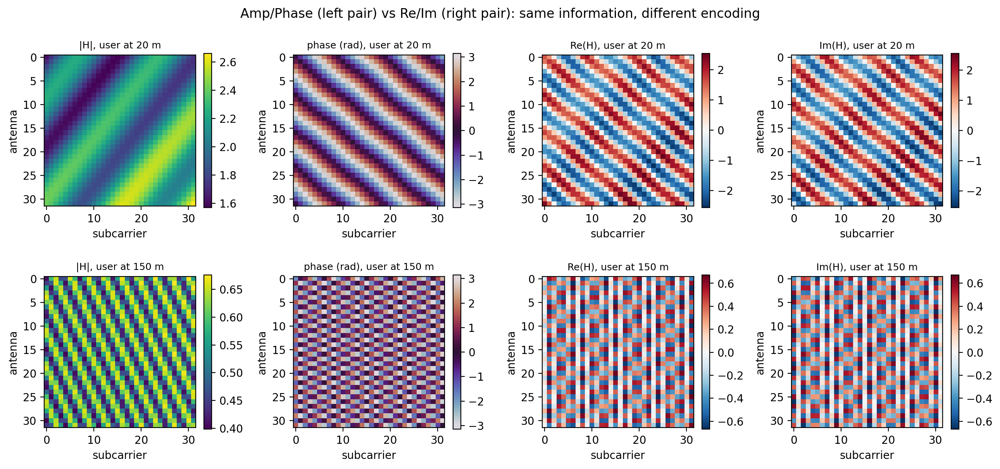
*The same CSI for a user 20 m from the gNB and a user 150 m away, in both encodings (scaled by the global factor). The far user's amplitude is about 4× lower. Its phase changes quickly between neighbouring antennas and subcarriers, which makes the phase image look almost random. The Re/Im channels show the same variation as smooth stripes.*

### CNN baseline (304,386 parameters)

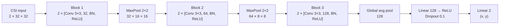

### Vision Transformer (536,834 parameters)

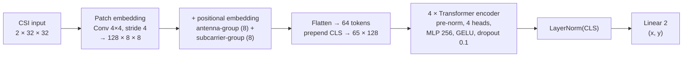

The positional embedding is factorised. One learned vector is assigned per
antenna group (the spatial/angle axis) and one per subcarrier group (the
frequency/delay axis), and the two are summed for each patch.

## Dataset generation

| Item | Value |
|---|---|
| Scenario | DeepMIMO v4 `o1_3p5` (outdoor O1, 3.5 GHz) |
| gNB | tx set t006, at the street intersection, (287.5, 589.5) m |
| Users | grid r000 (main street, 497,931 points) |
| Crop | y ∈ [400, 800] m (±200 m around the gNB) → 362,000 users with at least one path |
| Kept | 30,000, sampled at random (`rng(0)`) |
| LoS | 100 % of kept users |
| Array / band | ULA of 32 elements, λ/2 spacing, along y; 32 subcarriers over 50 MHz |
| Output | `data/csi_o1.mat` (H: 30000 × 32 × 32 complex64, pos, los, bs_pos, cfg) |


*O1 scenario: user grids r000–r002 and the 18 gNBs (t003–t020), produced by `explore_o1.m`. This project uses grid r000 (blue) with gNB t006.*


*`plot_rays.m`: ray-traced paths from t006 to a user 30 m away and a user 150 m away. Each has 4 paths. The red dashed line is the LoS path; the other paths are reflections.*


*`plot_csi.m`: |H| and Re(H) for a user 20 m from the gNB and a user 150 m away.*

**Why multipath matters.** The figures below are the sanity plots from
`generate_csi.m`, regenerated with only the strongest path and then with the 3
strongest paths. With a single path, |H| is constant across antennas and
subcarriers. The received power falls smoothly with distance, and the only
position information is in the linear phase ramps. With 3 paths, the paths
interfere and produce fringes in |H|. The power map shows rings around the gNB.
These are the patterns the models learn from. The
[multipath study](#extension-impact-of-multipath-richness) measures how they
affect localization.

| 1 path | 3 paths |
|---|---|
| 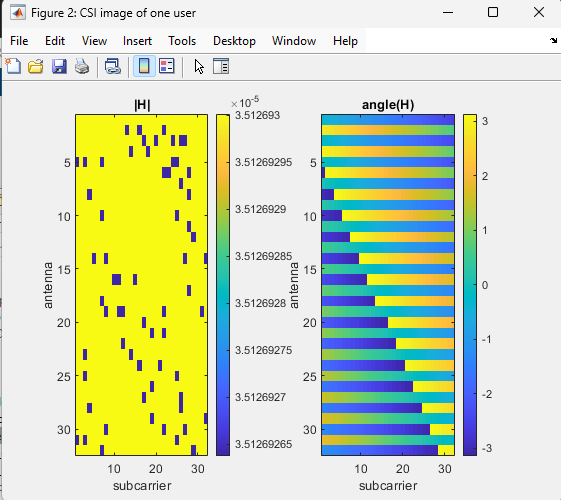 | 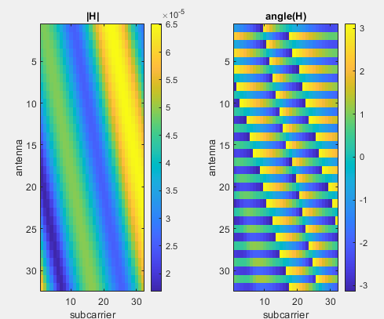 |
| 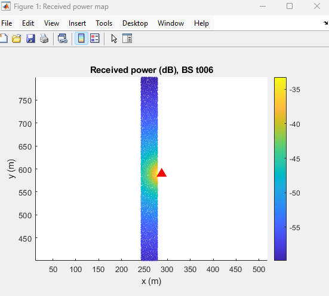 | 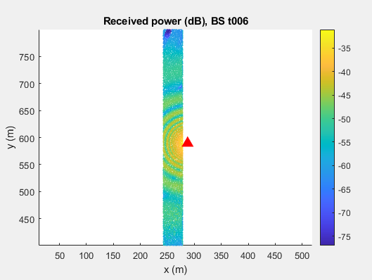 |

Instructions for downloading the scenario are in [data/README.md](data/README.md).

## How to reproduce

1. **Scenario.** Download `o1_3p5` into `data/o1_3p5/` (see [data/README.md](data/README.md)).
2. **MATLAB** (any working folder; paths are resolved from the repository root):
   - `matlab/explore_o1.m` (optional): prints units and value ranges and draws the layout.
   - `matlab/generate_csi.m`: writes `data/csi_o1.mat`.
   - For the multipath study, run `generate_csi.m` with `N_PATHS = 1`, `3` and `18`. The script always saves to `csi_o1.mat`, so rename the output after each run to `csi_o1_1path.mat`, `csi_o1_3paths.mat` and `csi_o1_18paths.mat`. The 18-path file holds the same channel as the one used in the main study.
   - `matlab/plot_csi.m` and `matlab/plot_rays.m` (optional): write `figs/csi_images.png` and `figs/rays.png`.
     `plot_rays.m` loads `inter_pos` (~400 MB) and needs a few GB of RAM.
   - The MATLAB runtimes were not measured.
3. **Notebook.** The results were produced on Google Colab with a T4 GPU:
   - Select a T4 GPU runtime.
   - Upload `csi_o1.mat` to `/content/`, or edit `DATA_PATH`.
   - Run all cells.

   Outputs go to `/content/csi_results/`: `results.json`, `models.pt` and `figs/`.
   They were then copied to `results/` and `figs/results/` in this repository.

   To run locally:
   - `pip install -r requirements.txt h5py`. The data-loading cell imports `h5py`.
   - Put `csi_o1.mat` in the notebook's working directory. Outputs are written to `results/` and `results/figs/`, relative to that directory.
4. **Multipath notebook** (`notebooks/multipath_study.ipynb`, also run on a Colab T4):
   - Upload the three `.mat` files to `/content/`, or set `DATA_DIR`.
   - Run all cells.

   Outputs go to `/content/csi_multipath/`: `results_multipath.json` and `figs/`.
   They were copied to `results/` and `figs/results/` (the `mp_*` figures).

   To run locally, the notebook reads the three files from its working directory and writes to `results_multipath/`.

Measured training times on a T4 (from the notebook output):

| Step | Runs | Time |
|---|---|---|
| Main experiment (2 inputs × 2 models × 3 seeds) | 12 | 2,232 s (~37 min) |
| Training-set size (25 % and 50 %, seed 0) | 8 | 639 s (~11 min) |
| CNN learning-rate check (seed 0) | 2 | 206 s (~3 min) |
| Extension: hybrid model (Re/Im, 3 seeds) | 3 | 947 s (~16 min) |
| **Total, main notebook** | 25 | **~67 min** |
| Multipath notebook (3 datasets × 2 models × 3 seeds) | 18 | 3,287 s (~55 min) |

Times per run: CNN 91–103 s, ViT 266–274 s, hybrid 305–321 s.

Three switches in the first code cell control what runs:
- `FAST = True` runs 2 epochs and 1 seed, as a quick end-to-end check.
- `RUN_DATA_SIZE = False` skips the training-set-size study.
- `RUN_CNN_LR_CHECK = False` skips the learning-rate check.

## Results

All numbers come from `results/results.json` and the notebook outputs. Errors are
measured on the 6,063 test users.

### Accuracy (mean ± std over seeds 0, 1, 2)

| Input | Model | Mean (m) | Median (m) | P90 (m) | RMSE (m) | Params | Inference (ms/sample, T4) |
|---|---|---|---|---|---|---|---|
| Amp/Phase | CNN | 5.06 ± 1.23 | 3.17 ± 0.65 | 8.15 ± 1.02 | 14.11 ± 4.89 | 304,386 | 0.036 |
| Amp/Phase | ViT | 5.45 ± 0.39 | 2.48 ± 0.05 | 6.12 ± 0.20 | 27.46 ± 2.09 | 536,834 | 0.057 |
| Re/Im | CNN | 6.35 ± 1.12 | 3.66 ± 0.81 | 10.35 ± 2.78 | 20.16 ± 2.15 | 304,386 | 0.037 |
| **Re/Im** | **ViT** | **2.89 ± 0.44** | **1.64 ± 0.13** | **4.05 ± 0.08** | 14.63 ± 4.86 | 536,834 | 0.057 |

Inference time is measured with a batch of 256 on the seed-0 model.

- **Re/Im + ViT is the best configuration** on mean, median and P90. Its mean error is less than half that of the CNN with the same input.
- **With Amp/Phase, the ViT loses most of its advantage.** Its median and P90 are still better than the CNN's, but its mean is slightly worse and its RMSE is the highest in the table (27.46 m). This means a small number of very large errors.
- **The CNN is less sensitive to the input encoding.** Amp/Phase does slightly better for it (5.06 m vs 6.35 m), but its seed-to-seed std is above 1 m in both cases, so the gap is within that spread.
- RMSE is much larger than the mean for every configuration. It is driven by a few large errors (see [Outliers](#outliers)).

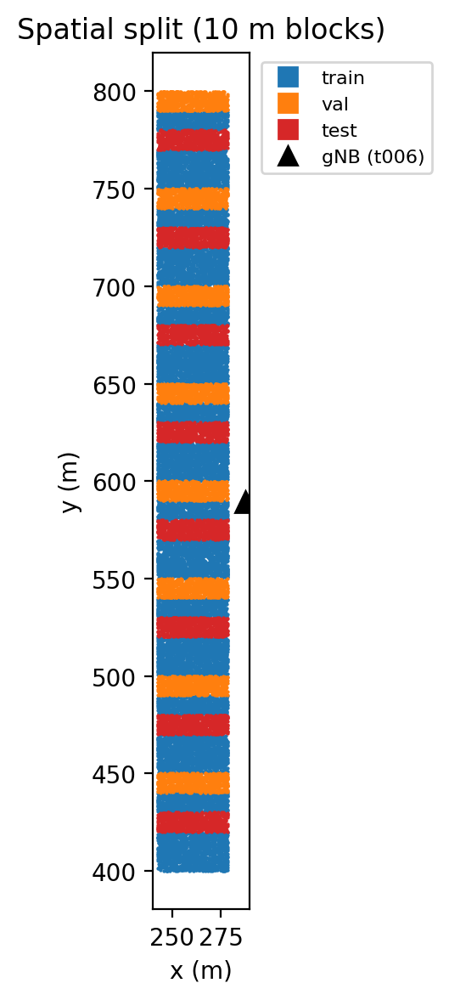
*Spatial split: alternating 10 m blocks along the street for train, validation and test.*

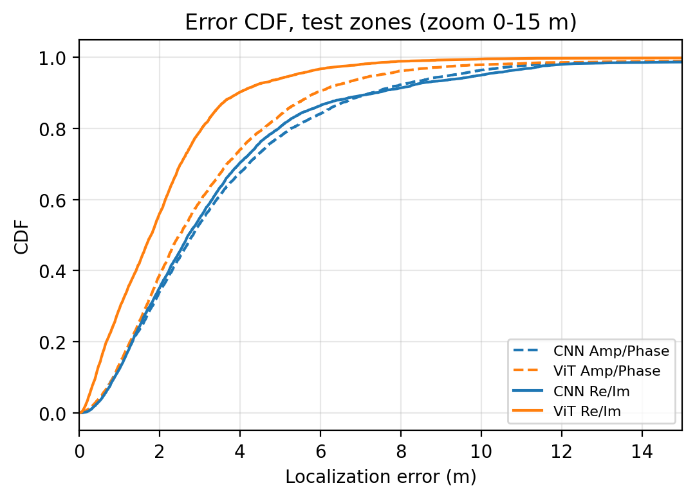
*Error CDF on test zones, zoomed to 0–15 m, for seed 0. The ViT with Re/Im (solid orange) stays to the left of the other three curves. The other three are close to each other, and the ViT with Amp/Phase is slightly ahead of the two CNNs.*

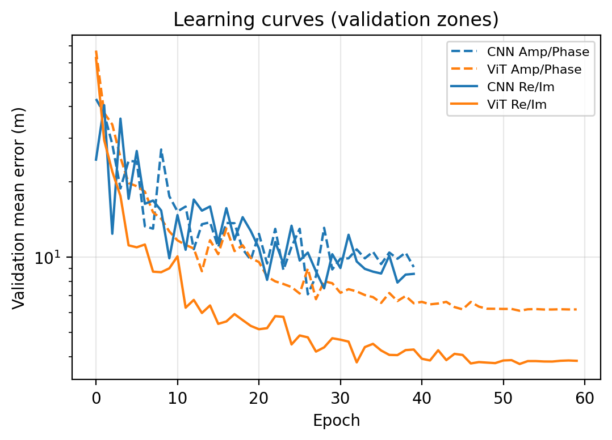
*Validation mean error per epoch (log scale), seed 0. The ViT with Re/Im converges to the lowest error. Both CNNs oscillate strongly from epoch to epoch. The ViT with Amp/Phase levels off higher, at about 6 m.*

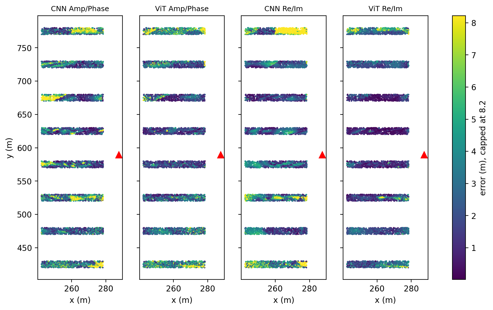
*Error for each test user along the street, seed 0 (colour scale capped at the 95th percentile, 8.2 m). The largest errors are in the blocks farthest from the gNB (y ≈ 425 m and y ≈ 775 m) and around y ≈ 525 m. The ViT with Re/Im has the fewest high-error patches.*

### Outliers

Seed 0, errors > 50 m:

| Input | Model | Errors > 50 m | Of these, on the wrong side of the gNB | Mean \|y − y_gNB\| |
|---|---|---|---|---|
| Amp/Phase | CNN | 32 (0.53 %) | 28 % | 165 m |
| Amp/Phase | ViT | 39 (0.64 %) | 85 % | 168 m |
| Re/Im | CNN | 39 (0.64 %) | 62 % | 159 m |
| Re/Im | ViT | 7 (0.12 %) | 57 % | 177 m |

All large errors occur for users far from the gNB, about 160–180 m on average.
Many of them are north/south mirror confusions: 85 % of the ViT's large errors
with Amp/Phase, and around 60 % for the Re/Im models.

The cause is the array geometry. The ULA lies along the street, so far users are
seen close to endfire (sinθ·sinφ ≈ ±1). With λ/2 spacing, the phase progressions
e^{jπm} and e^{−jπm} are identical, so the array cannot tell the two directions
apart. The model must then rely on the delay and power cues alone. This is also
why the Amp/Phase ViT has a high RMSE despite a low median: its few large errors
are mostly mirror errors of about 300 m.

### Robustness to noise (test-time AWGN, no retraining, seed 0)

Mean error (m). The noiseless column is the seed-0 result.

| Input | Model | 0 dB | 5 dB | 10 dB | 15 dB | 20 dB | 30 dB | noiseless |
|---|---|---|---|---|---|---|---|---|
| Amp/Phase | CNN | 70.51 | 33.89 | 13.33 | 6.13 | 4.29 | 4.15 | 4.18 |
| Amp/Phase | ViT | 72.23 | 31.38 | 13.65 | 8.30 | 5.91 | 4.99 | 4.89 |
| Re/Im | CNN | 55.10 | 21.28 | 7.02 | 4.63 | 4.66 | 4.77 | 4.82 |
| Re/Im | ViT | 52.33 | 20.07 | 5.25 | 2.49 | 2.32 | 2.29 | 2.31 |

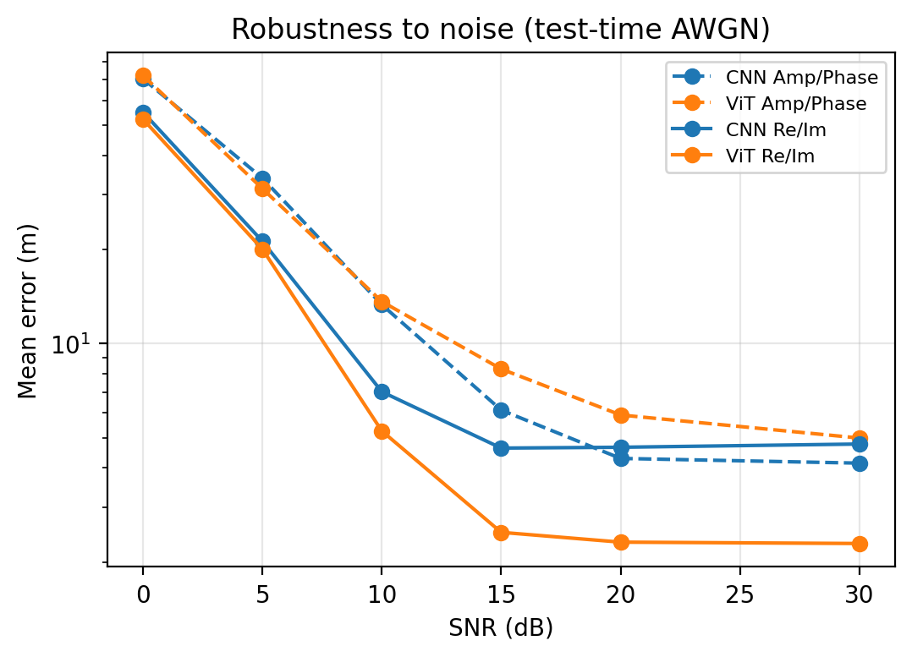

- **Re/Im is much more robust to noise than Amp/Phase.**
  - The Re/Im models stay at their noiseless error down to 15 dB.
  - The Amp/Phase models already degrade at 20 dB (ViT) and at 15 dB (both).
  - At 10 dB, the Amp/Phase models' error is about twice that of the Re/Im models.
- A likely reason is that at low amplitude the phase is dominated by noise, and the `amp_phase` input presents that phase at full scale whatever the amplitude. In Re/Im, the noise on a weak coefficient stays small.
- At 5 dB and 0 dB, all models fail (errors of 20–72 m). All models were trained on noiseless CSI only.

### Training-set size (seed 0)

Mean test error (m):

| Input | Model | 25 % (4,486) | 50 % (8,973) | 100 % (17,947) |
|---|---|---|---|---|
| Amp/Phase | CNN | 8.32 | 8.54 | 4.18 |
| Amp/Phase | ViT | 10.49 | 10.32 | 4.89 |
| Re/Im | CNN | 5.66 | 3.92 | 4.82 |
| Re/Im | ViT | 3.36 | 3.57 | 2.31 |

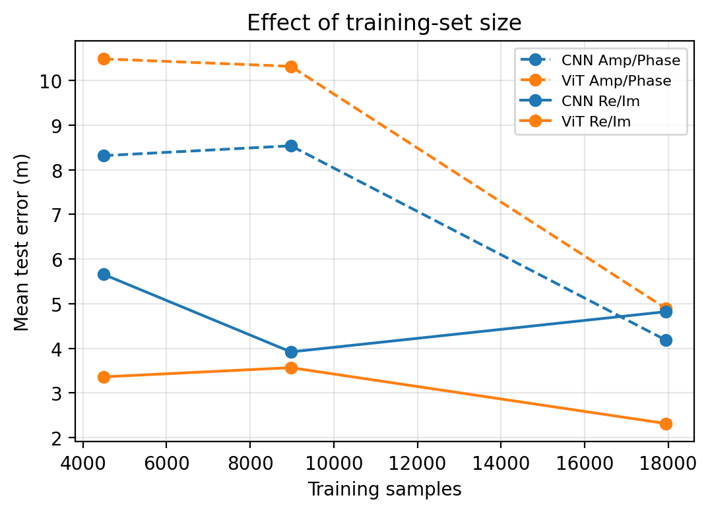

- **With Re/Im, the ViT has the lowest error at every training-set size**, including 25 %.
- **The Amp/Phase models need the full training set.** At 25 % and 50 % their errors are about twice their full-data error.
- Neither curve is strictly monotonic: Re/Im CNN is best at 50 %, and Re/Im ViT is slightly worse at 50 % than at 25 %. Each point comes from a single seed, and the main-experiment std (0.4–1.2 m) is of the same order as these differences.

### CNN learning-rate check (seed 0)

This check asks whether the CNN baseline is under-tuned. Retraining it with a max
LR of 1e-3 instead of 2e-3 gives:

| Input | LR 2e-3 | LR 1e-3 |
|---|---|---|
| Amp/Phase | 4.18 m | 5.40 m |
| Re/Im | 4.82 m | 4.82 m |

A lower learning rate does not help, so the gap between the CNN and the ViT is
not caused by the CNN's learning rate.

## Extension: hybrid CNN-Transformer

The hybrid model changes only the tokeniser. The ViT cuts 4×4 patches with one
linear projection. The hybrid builds the same 8 × 8 grid of 128-dimensional tokens
with three 3×3 convolutions. The positional embedding, CLS token, encoder and head
are identical to the ViT's, so any difference comes from the convolutional stem.
The hybrid is trained like the ViT (60 epochs, max LR 1e-3, 3 seeds, Re/Im input)
and has 625,762 parameters.

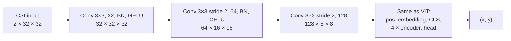

Re/Im input, mean ± std over 3 seeds:

| Model | Mean (m) | Median (m) | P90 (m) | RMSE (m) | Errors > 50 m (avg over seeds) | Params | ms/sample (T4) |
|---|---|---|---|---|---|---|---|
| CNN | 6.35 ± 1.12 | 3.66 ± 0.81 | 10.35 ± 2.78 | 20.16 ± 2.15 | 0.86 % | 304,386 | 0.037 |
| ViT | 2.89 ± 0.44 | 1.64 ± 0.13 | 4.05 ± 0.08 | 14.63 ± 4.86 | 0.35 % | 536,834 | 0.057 |
| **Hybrid** | **2.33 ± 0.05** | 1.65 ± 0.06 | 4.12 ± 0.11 | **7.62 ± 1.71** | **0.13 %** | 625,762 | 0.066 |

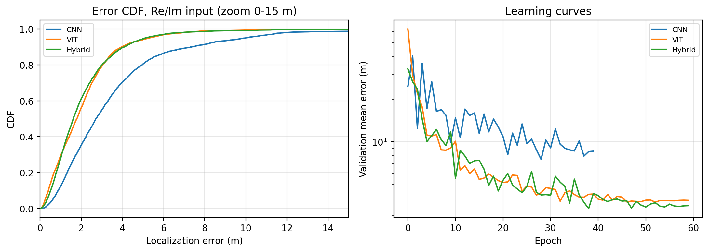
*Left: error CDF (seed 0). The ViT and hybrid curves almost overlap and are well ahead of the CNN. Right: validation learning curves. After about epoch 45, the hybrid ends slightly below the ViT.*

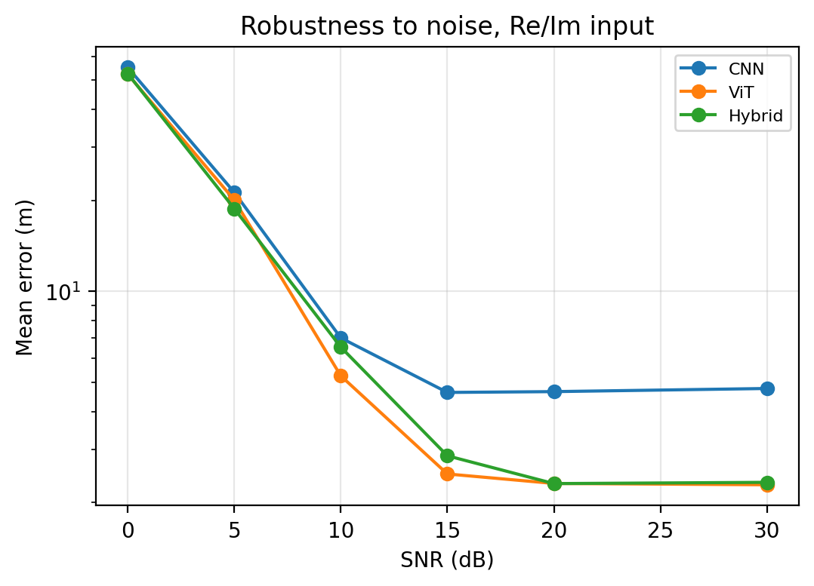

| SNR (dB) | 0 | 5 | 10 | 15 | 20 | 30 |
|---|---|---|---|---|---|---|
| CNN | 55.10 | 21.28 | 7.02 | 4.63 | 4.66 | 4.77 |
| ViT | 52.33 | 20.07 | 5.25 | 2.49 | 2.32 | 2.29 |
| Hybrid | 52.57 | 18.79 | 6.54 | 2.86 | 2.31 | 2.33 |

- The hybrid has the same median and P90 as the ViT. Its mean error and RMSE are lower and it has fewer large errors, so the gain comes mainly from avoiding outliers.
- The hybrid's results are also much more consistent across seeds (std 0.05 m on the mean, against 0.44 m for the ViT).
- Under noise, the hybrid and the ViT are similar. The hybrid is slightly better at 5 dB and slightly worse at 10 and 15 dB.

## Extension: impact of multipath richness

Notebook: `notebooks/multipath_study.ipynb`. Results: `results/results_multipath.json`.

**Setup.** Three datasets are generated with `generate_csi.m`, keeping the
`N_PATHS` strongest paths per user:

| Dataset | Paths kept | Description |
|---|---|---|
| 1 path | 1 | strongest path only: an artificial channel with no reflections |
| 3 paths | 3 | strongest path + the 2 strongest reflections |
| 18 paths | all (≤ 17 stored) | the realistic channel of the main study |

Everything else is identical across the three datasets:
- The same 30,000 users. The notebook asserts that positions match across the three files.
- The same split, Re/Im input, CNN and ViT architectures and training settings.
- Seeds 0, 1 and 2.

The global scale is computed separately on each dataset's training set.

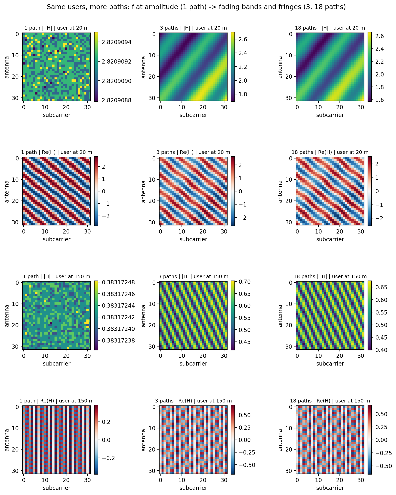
*The same two users (20 m and 150 m from the gNB) in the three datasets. With 1 path, |H| is flat: its variation is below 10⁻⁶ of its value. Re(H) then only shows the linear phase ramps. With 3 and 18 paths, |H| shows fading bands. The 3-path and 18-path images are very close, so the two strongest reflections carry most of the structure.*

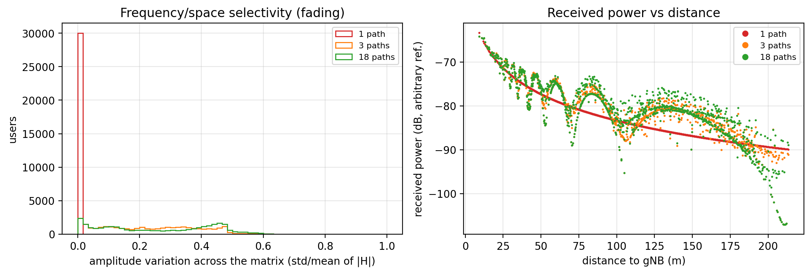
*Left: amplitude variation across the 32 × 32 matrix (std/mean of |H|) for every user. It is zero with 1 path, and spreads up to about 0.6 with 3 and 18 paths. Right: received power vs distance. With 1 path it decreases smoothly, so it maps one-to-one to distance. With 3 and 18 paths, interference adds ripples of several dB, so the same power level occurs at several distances.*

### Accuracy (mean ± std over 3 seeds)

| Paths | Model | Mean (m) | Median (m) | P90 (m) | RMSE (m) | Errors > 50 m (%) |
|---|---|---|---|---|---|---|
| 1 | CNN | 5.63 ± 0.41 | 2.53 ± 0.36 | 7.38 ± 1.54 | 18.25 ± 4.54 | 1.74 ± 0.39 |
| 1 | ViT | **2.23 ± 0.65** | **1.47 ± 0.37** | **3.74 ± 0.49** | **8.16 ± 4.94** | **0.15 ± 0.12** |
| 3 | CNN | 10.17 ± 0.49 | 2.50 ± 0.19 | 6.67 ± 0.19 | 47.47 ± 3.16 | 2.55 ± 0.04 |
| 3 | ViT | 6.46 ± 0.98 | 1.51 ± 0.23 | 4.21 ± 0.31 | 39.06 ± 4.58 | 1.41 ± 0.23 |
| 18 | CNN | 4.43 ± 0.35 | 2.48 ± 0.23 | 6.30 ± 0.60 | 18.33 ± 0.63 | 0.68 ± 0.03 |
| 18 | ViT | 2.89 ± 0.44 | 1.64 ± 0.13 | 4.05 ± 0.08 | 14.63 ± 4.86 | 0.35 ± 0.18 |

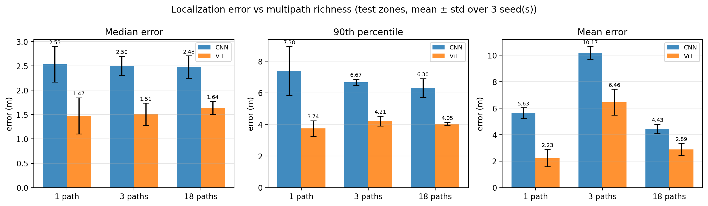

- **The ViT beats the CNN on every dataset and every metric.**
- **The median error hardly depends on the number of paths.** It is 2.48–2.53 m for the CNN and 1.47–1.64 m for the ViT, and the differences are within one std.
- **The mean error depends mostly on large errors.**
  - The 3-path dataset has the most errors over 50 m (2.55 % for the CNN, 1.41 % for the ViT). Its mean and RMSE are therefore the worst, even though its median is as good as the others.
  - Going from 3 to 18 paths brings the large errors back down.
- **With 1 path, the ViT has the lowest mean error and the fewest large errors.** The CNN does worse with 1 path than with 18. A likely reason: with a single path, received power is a clean, monotonic distance cue and the phase ramps give the angle, and the ViT uses this better.
- **The validation curves rank the datasets differently.** On the validation zones, the seed-0 ViT is best with 18 paths (3.73 m), then 3 paths (4.78 m), then 1 path (6.80 m) (see the learning curves below). On the test zones the 1-path ViT is best. The 1-path advantage on the test set is therefore not consistent across held-out zones, and should not be read as "fewer paths is better".

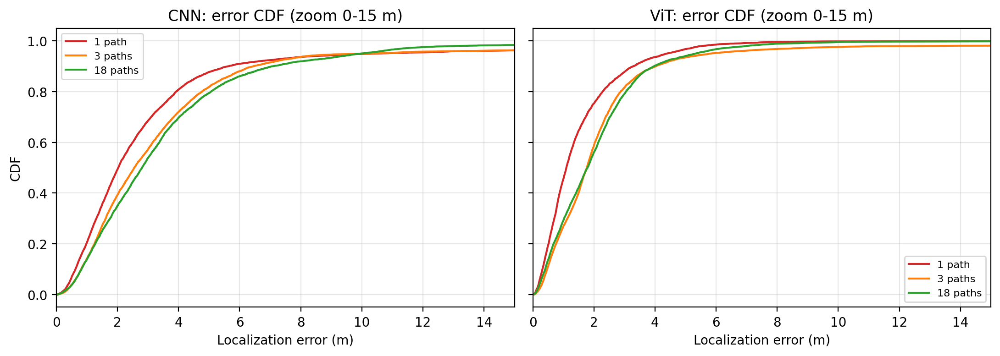
*Error CDF, zoomed to 0–15 m (seed 0), for the CNN (left) and the ViT (right).*

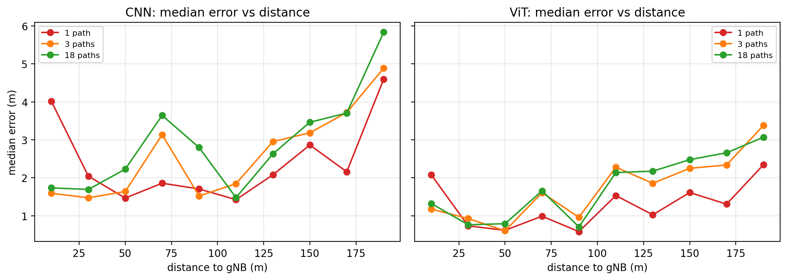
*Median error per 20 m distance bin (seed 0). Median error grows with distance from the gNB for every dataset. For the ViT, the 1-path model has the lowest median in almost every bin beyond 25 m. For the CNN, the 1-path model is worst within 20 m of the gNB (about 4 m) and lowest or close to lowest in most bins beyond that.*

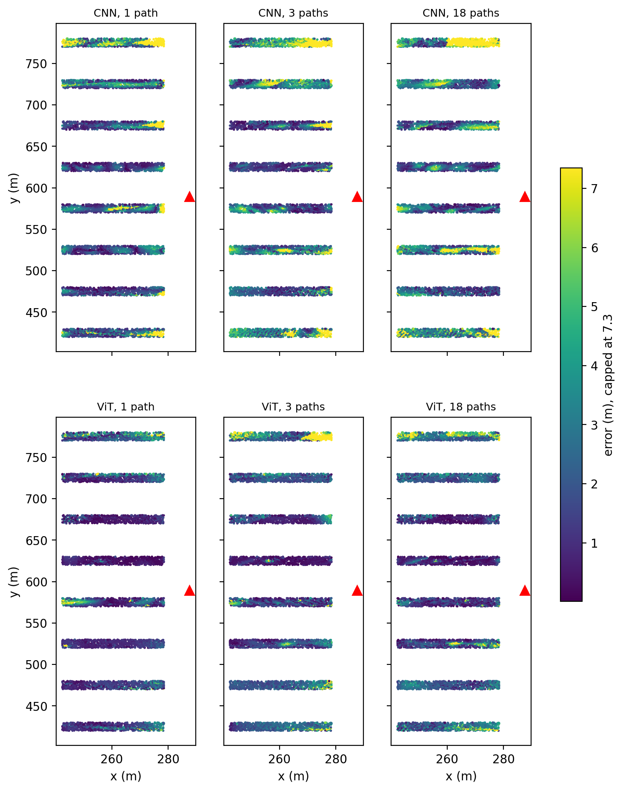
*Error for each test user (seed 0, colour capped at 7.3 m). The high-error areas are the far ends of the street (y ≈ 425 m and y ≈ 775 m) and, for the CNN, around y ≈ 525 m. The ViT with 1 path has the most uniform map.*

### Large errors and mirror confusions (seed 0)

| Paths | Model | Errors > 50 m | Of these, on the wrong side of the gNB |
|---|---|---|---|
| 1 | CNN | 128 (2.11 %) | 34 % |
| 1 | ViT | 1 (0.02 %) | 0 % |
| 3 | CNN | 156 (2.57 %) | 81 % |
| 3 | ViT | 104 (1.72 %) | 91 % |
| 18 | CNN | 43 (0.71 %) | 56 % |
| 18 | ViT | 7 (0.12 %) | 57 % |

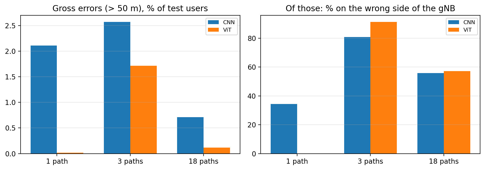

With 3 paths, 81–91 % of the large errors are north/south mirror confusions, the
endfire ambiguity described in [Outliers](#outliers). With 1 path, the ViT makes
almost no such errors. A plausible explanation is that the single path's
smooth power-vs-distance curve and clean phase ramps leave little room for
confusion. With 3 paths, the ripples in power and the extra fringes give similar
fingerprints on both sides of the gNB. With 18 paths, the weaker reflections add
detail that separates the two sides again. This interpretation is not tested
directly in the notebook.

### Robustness to noise (test-time AWGN, seed 0)

Mean error (m):

| Paths | Model | 0 dB | 5 dB | 10 dB | 15 dB | 20 dB | 30 dB |
|---|---|---|---|---|---|---|---|
| 1 | CNN | 51.92 | 26.47 | 13.57 | 8.27 | 6.51 | 5.90 |
| 1 | ViT | 80.64 | 55.63 | 21.11 | 5.95 | 2.56 | 1.59 |
| 3 | CNN | 42.37 | 17.93 | 13.07 | 11.22 | 10.84 | 10.74 |
| 3 | ViT | 48.30 | 17.54 | 9.24 | 7.82 | 7.83 | 7.77 |
| 18 | CNN | 49.09 | 18.40 | 6.55 | 4.62 | 4.72 | 4.84 |
| 18 | ViT | 52.33 | 20.07 | 5.25 | 2.49 | 2.32 | 2.29 |

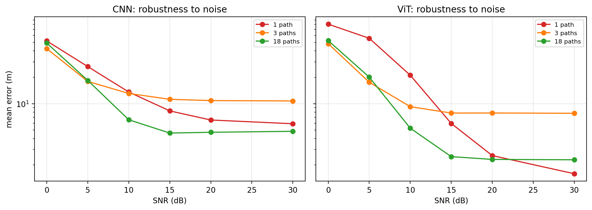

- **The 1-path ViT is the most accurate model at 30 dB and the most fragile under noise.**
  - Its error grows from 1.59 m at 30 dB to 5.95 m at 15 dB, and to 21.1 m at 10 dB.
  - At 5 dB and 0 dB it is the worst of all six models.
  - With one path, the only information is the smooth phase ramps and the power level, and noise corrupts both.
- **The 18-path models are the most robust.** They stay close to their noiseless error down to 15 dB and have the lowest error at 10 dB.
- **The 3-path models are flat from 30 dB down to 10–15 dB**, but at a high level (about 7.8 m for the ViT and 10.8 m for the CNN), set by their large errors.

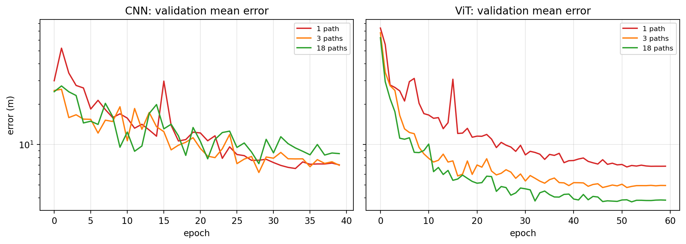
*Validation mean error per epoch (seed 0). For the ViT, 18 paths converges lowest and 1 path highest. The CNN curves are close together and noisy.*

**Run-to-run variation of the CNN.** The 18-path setting matches the Re/Im setting
of the main study: same data, seeds and hyper-parameters. The ViT results are
identical in both notebooks (2.89 ± 0.44 m). The CNN results are not: 4.43 ± 0.35 m
here, against 6.35 ± 1.12 m in the main notebook. GPU convolution kernels are not
deterministic by default, and this CNN appears sensitive to that. CNN
differences of 1–2 m between runs should therefore be treated as noise.

## Limitations and future work

**Limitations**

- The scene is a static ray-traced model: there is no mobility, no change in the environment and no hardware impairments.
- Timing synchronisation is perfect. In practice a timing offset would shift every delay.
- The model uses 32 subcarriers instead of the thousands a real NR carrier has. With Δf = 1.5625 MHz, delays are unambiguous only up to 1/Δf = 640 ns, i.e. about 192 m of path length.
- Users are on the main street only and are all in LoS. NLoS positions are not tested.
- The array is a ULA aligned with the street rather than a sectorised UPA, which causes the north/south ambiguity described above.
- The models were trained on noiseless CSI, with no noise augmentation.
- Only 3 seeds are used for the main results. The noise, training-set-size, outlier and learning-rate studies use seed 0 only.
- Training on GPU is not bit-reproducible: the CNN gives different results for the same seed in the two notebooks (see the multipath section).
- Validation and test zones can rank configurations differently (for example the 1-path vs 18-path ViT), so conclusions drawn from a single test split are fragile.

**Future work**

- Train with noise augmentation over a range of SNRs, especially for the Amp/Phase input.
- Add NLoS areas (grids r001 and r002) and several gNBs.
- Use a UPA or an array not aligned with the street to remove the endfire ambiguity.
- Simulate more realistic SRS configurations (more subcarriers, comb structure) and timing offsets.
- Run all studies over several seeds and test other input encodings, for example log-amplitude, or phase differences between neighbouring antennas.
- Use cross-validation over the spatial blocks (rotating which blocks are test and validation) to check whether the multipath ranking holds.
- Enable deterministic GPU kernels (`torch.use_deterministic_algorithms(True)`) so that runs can be reproduced exactly.

## Repository structure

```
.
├── README.md
├── requirements.txt
├── .gitignore
├── matlab/
│   ├── dm_load.m          load one DeepMIMO v4 matrix file
│   ├── explore_o1.m       layout map, units and value ranges
│   ├── generate_csi.m     build data/csi_o1.mat
│   ├── plot_csi.m         CSI images of a near and a far user
│   └── plot_rays.m        3D ray-traced paths for two users
├── notebooks/
│   ├── csi_localization_final.ipynb   split, encodings, CNN, ViT, hybrid, evaluation
│   └── multipath_study.ipynb          1 / 3 / 18 paths, CNN and ViT
├── data/                  (contents gitignored)
│   ├── README.md          how to get o1_3p5 and generate csi_o1.mat
│   ├── o1_3p5/            DeepMIMO scenario (~21 GB)
│   ├── csi_o1_1path.mat   CSI with the strongest path only
│   ├── csi_o1_3paths.mat  CSI with the 3 strongest paths
│   └── csi_o1_18paths.mat CSI with all paths (= csi_o1.mat of the main study, ~218 MB)
├── results/
│   ├── results.json             main study: metrics (per seed, mean ± std), outliers, SNR, data size, LR check, hybrid
│   ├── results_multipath.json   multipath study: metrics, gross errors, SNR
│   └── models.pt                seed-0 weights of the 4 (input, model) pairs of the main study (6.8 MB)
├── figs/
│   ├── matlab/            scenario layout, rays, CSI images, 1-path / 3-path sanity plots
│   └── results/           notebook figures (mp_* = multipath study)
└── docs/
    └── resources.md       learning resources (videos)
```

## References

1. A. Alkhateeb, "DeepMIMO: A Generic Deep Learning Dataset for Millimeter Wave and Massive MIMO Applications," *Information Theory and Applications Workshop (ITA)*, 2019. [arXiv:1902.06435](https://arxiv.org/abs/1902.06435)
2. DeepMIMO dataset and scenarios: <https://www.deepmimo.net>
3. A. Dosovitskiy et al., "An Image is Worth 16x16 Words: Transformers for Image Recognition at Scale," *ICLR*, 2021. [arXiv:2010.11929](https://arxiv.org/abs/2010.11929)
4. 3GPP TR 38.843, "Study on Artificial Intelligence (AI)/Machine Learning (ML) for NR air interface," Release 18.
