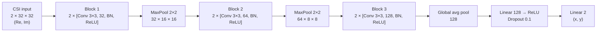
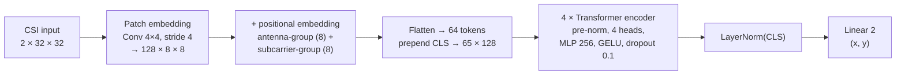
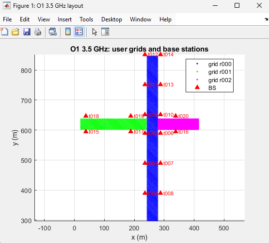
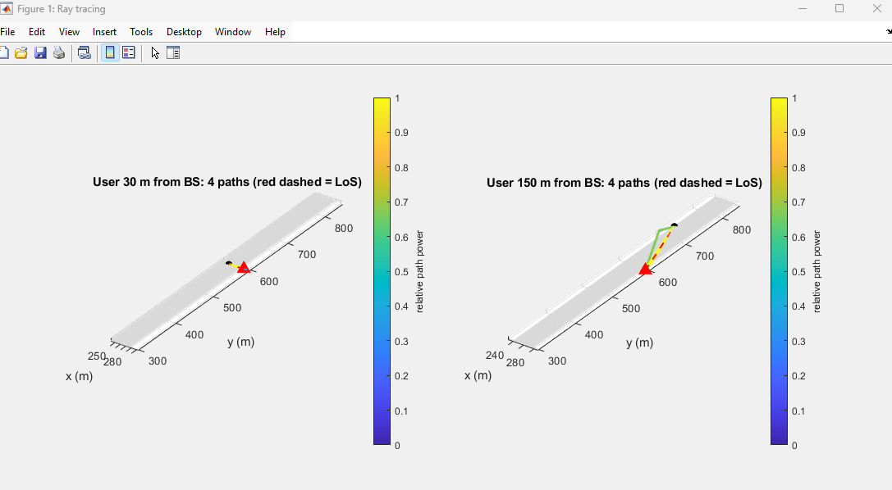
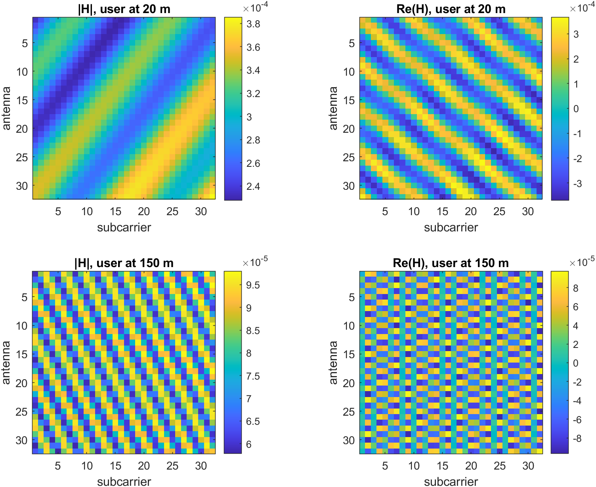
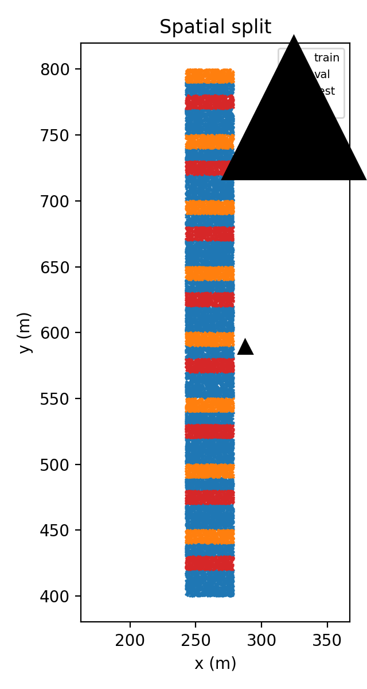
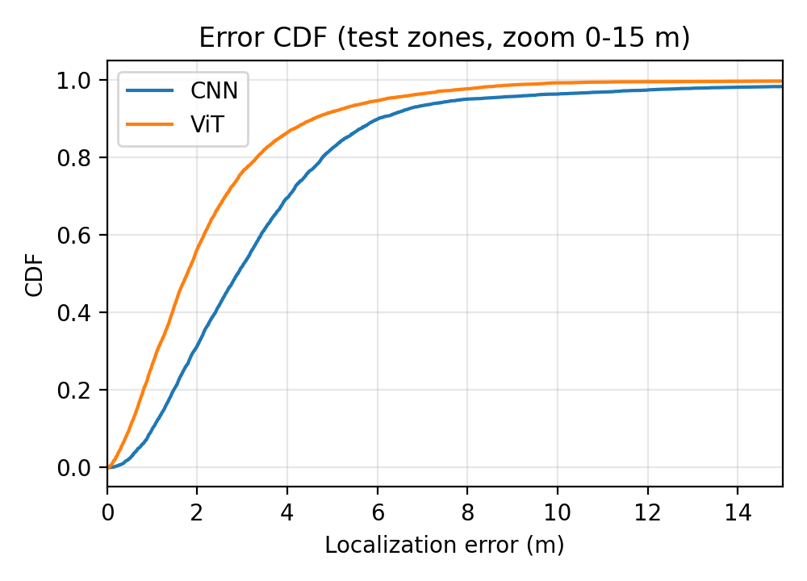
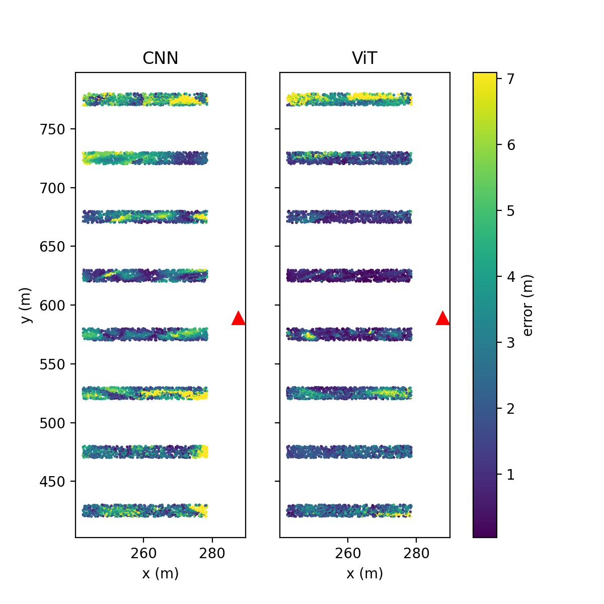
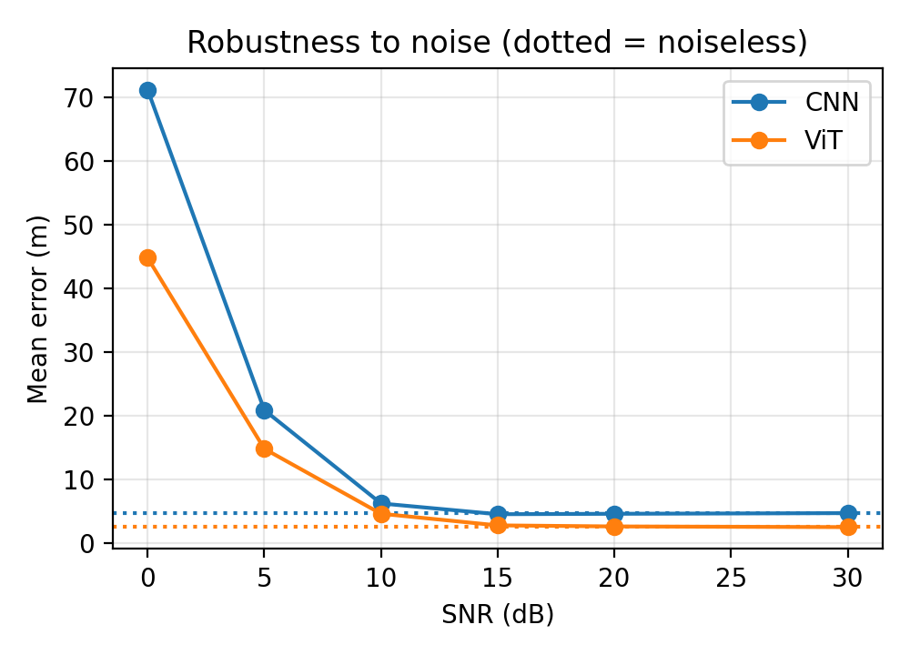
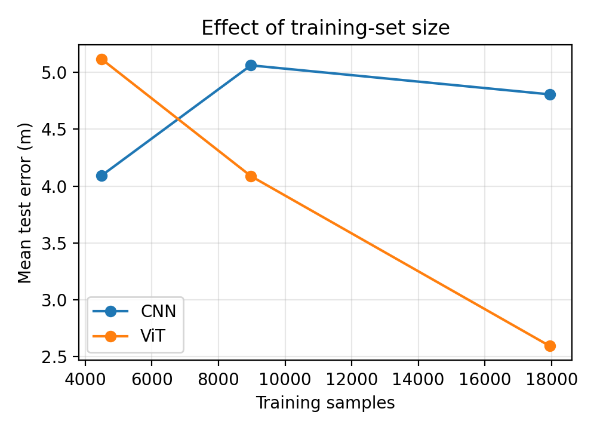

# CSI-based 5G UE localization: Vision Transformer vs CNN

The gNB measures the uplink channel (CSI) of a single-antenna UE on 32 antennas × 32
subcarriers. A deep network then regresses the UE's (x, y) position from that CSI
"image", an approach known as CSI fingerprinting. The data come from the DeepMIMO
ray-tracing scenario `o1_3p5` (outdoor O1, 3.5 GHz, NR band n78): 30,000 users on a
400 m stretch of street around one gNB. On test zones held out spatially, a small
Vision Transformer (ViT) reaches a mean error of **2.59 m** and a median of **1.78 m**.
A CNN baseline reaches **4.81 m** and **2.91 m**. Both models run inference in about
0.4 ms per sample on a CPU.

*Course: Futurs Réseaux Radio Mobiles, INSAT RT5, Project 03 (solo project).*

---

## Contents

- [Context](#context)
- [Method](#method)
- [Dataset generation](#dataset-generation)
- [How to reproduce](#how-to-reproduce)
- [Results](#results)
- [Limitations and future work](#limitations-and-future-work)
- [Repository structure](#repository-structure)
- [References](#references)

---

## Context

Positioning has been a native 5G NR feature since 3GPP Release 16. That release
defines downlink and uplink TDOA, multi-RTT, angle-based methods (DL-AoD, UL-AoA)
and uplink SRS for positioning. These methods need good line-of-sight geometry
and precise synchronisation.

**AI/ML for positioning** takes a different approach: a model learns the mapping
from measured channel to position directly. Release 18 studied this as one of the
AI/ML-for-air-interface use cases (TR 38.843, "direct AI/ML positioning"). AI-native
air interfaces and integrated sensing are also expected features of 6G.

This project tests whether a ViT, which is attention-based, uses the
antenna × subcarrier structure of the CSI better than a CNN with a comparable
budget.

## Method

### Signal model

The scenario stores, for each user and each path *l*: power (dB), phase (deg),
delay τ (s) and departure angles (azimuth φ and zenith θ, in degrees). The
channel is built in MATLAB for a uniform linear array (ULA) of 32 elements with
λ/2 spacing along the y axis, and for 32 subcarriers spread over 50 MHz
(Δf = 1.5625 MHz):

$$H(m,k) = \sum_{l} g_l \, e^{\,j\pi m \sin\theta_l \sin\phi_l} \, e^{-j2\pi f_k \tau_l}$$

Here g_l = √P_l · e^{jϕ_l}, m = 0…31 and f_k = k·Δf. The script keeps the 20 strongest
paths per user. For t006 / r000 the scenario stores at most 17 paths, so in practice
every path is kept.

### Pipeline (`notebooks/csi_localization.ipynb`)

1. **Load** `data/csi_o1.mat`.
2. **Spatial split.** The street is cut into 10 m blocks along y. Blocks with
   index % 5 == 2 go to test, == 4 to validation, and the rest to training
   (17,947 / 5,990 / 6,063 samples). Whole blocks are held out because a random
   split would put almost identical neighbours in both train and test.
3. **Preprocessing.** Complex CSI is converted to 2 real channels (Re, Im) and
   divided by a single global scale (the RMS of the training set). Per-sample
   normalisation is avoided so that received power remains usable as a distance
   cue. Target positions are standardised with training-set statistics.
4. **Models**: see the diagrams below.
5. **Training.** AdamW (weight decay 0.05), OneCycle learning rate, SmoothL1 loss
   (β = 0.05), batch size 256. The checkpoint with the best validation mean error
   is kept. CNN: max LR 2e-3, 40 epochs. ViT: max LR 1e-3, 60 epochs. Trained on
   CPU.
6. **Evaluation.** Mean, median, 90th percentile and RMSE of the error; inference
   time; error CDF; learning curves; error map; robustness to test-time AWGN;
   effect of training-set size; analysis of outliers.

### CNN baseline (304,386 parameters)



### Vision Transformer (536,834 parameters)



The positional embedding is factorised. One learned vector is assigned per
antenna group (the spatial/angle axis) and one per subcarrier group (the
frequency/delay axis), and the two are summed for each patch.

## Dataset generation

| Item | Value |
|---|---|
| Scenario | DeepMIMO v4 `o1_3p5` (outdoor O1, 3.5 GHz) |
| gNB | tx set t006, at the street intersection, (287.5, 589.5) m |
| Users | grid r000 (main street, 497,931 points) |
| Crop | y ∈ [400, 800] m (±200 m around the gNB) → 362,000 users with at least one path |
| Kept | 30,000, sampled at random (`rng(0)`) |
| LoS | 100 % of kept users |
| Array / band | ULA of 32 elements, λ/2 spacing, along y; 32 subcarriers over 50 MHz |
| Output | `data/csi_o1.mat` (H: 30000 × 32 × 32 complex64, pos, los, bs_pos, cfg) |


*O1 scenario: user grids r000–r002 and the 18 gNBs (t003–t020), produced by `explore_o1.m`. This project uses grid r000 (blue) with gNB t006.*


*`plot_rays.m`: ray-traced paths from t006 to a user 30 m away and a user 150 m away. Each has 4 paths. The red dashed line is the LoS path; the other paths are reflections.*


*`plot_csi.m`: |H| and Re(H) for a user 20 m from the gNB and a user 150 m away. The far user's amplitude is about 4× lower and its pattern varies faster across antennas and subcarriers. This difference in level is why a single global scale is used instead of per-sample normalisation.*

Instructions for downloading the scenario are in [data/README.md](data/README.md).

## How to reproduce

```bash
pip install -r requirements.txt
```

1. **Scenario.** Download `o1_3p5` into `data/o1_3p5/` (see [data/README.md](data/README.md)).
2. **MATLAB** (any working folder; paths are resolved from the repository root):
   - `matlab/explore_o1.m` (optional): prints units and value ranges and draws the layout.
   - `matlab/generate_csi.m`: writes `data/csi_o1.mat`.
   - `matlab/plot_csi.m` and `matlab/plot_rays.m` (optional): write `figs/csi_images.png` and `figs/rays.png`.
     `plot_rays.m` loads `inter_pos` (~400 MB) and needs a few GB of RAM.
   - The MATLAB runtimes were not measured.
3. **Notebook.** Open `notebooks/csi_localization.ipynb` and run all cells. It reads
   `data/`, writes figures to `figs/`, and writes `results/results.json` and
   `results/models.pt`.

Measured CPU runtimes (from the notebook output):

| Step | Time |
|---|---|
| CNN training (40 epochs) | 896 s (~15 min) |
| ViT training (60 epochs) | 6,146 s (~1 h 42 min) |
| Training-set-size study (CNN and ViT at 25 % and 50 %) | 291 + 1,548 + 973 + 4,720 s (~2 h 6 min) |
| **Full notebook** | **~4 h** |

To skip the training-set-size study (about 2 h), set `RUN_DATA_SIZE = False`. To
run a quick end-to-end check with 3 epochs per model, set `FAST = True`.

Software versions: Python 3.13.9, numpy 2.2.6, scipy 1.17.0, torch 2.15.0 (CPU), matplotlib 3.10.8.

## Results

All numbers below come from `results/results.json` and the notebook outputs.
Errors are measured on the 6,063 test users.

### Accuracy and cost

| Model | Mean (m) | Median (m) | P90 (m) | RMSE (m) | Params | Inference (ms/sample, CPU) |
|---|---|---|---|---|---|---|
| CNN | 4.81 | 2.91 | 6.04 | 18.84 | 304,386 | 0.41 |
| **ViT** | **2.59** | **1.78** | **4.60** | **8.84** | 536,834 | 0.37 |

The ViT is better on every metric. RMSE is much larger than the mean for both
models, so a small number of large errors dominate it (see [Outliers](#outliers)).
Inference time is measured per batch of 256 (104.7 ms for the CNN, 95.7 ms for
the ViT); the table divides by 256.


*Spatial split: alternating 10 m blocks along the street for train, validation and test. The black triangle is the gNB.*


*Error CDF on test zones, zoomed to 0–15 m. The ViT curve stays to the left of the CNN curve across the whole range.*


*Error for each test user along the street (colour scale clipped at the 95th percentile). Both models make their largest errors in the blocks farthest from the gNB (y ≈ 425 m and y ≈ 775 m) and around y ≈ 525 m. The CNN shows more high-error patches than the ViT.*

Other figures: `figs/cdf.png` (full CDF) and `figs/learning_curves.png`.

### Robustness to noise (test-time AWGN, no retraining)

Mean error (m):

| SNR (dB) | 0 | 5 | 10 | 15 | 20 | 30 | noiseless |
|---|---|---|---|---|---|---|---|
| CNN | 71.12 | 20.91 | 6.28 | 4.60 | 4.66 | 4.77 | 4.81 |
| ViT | 44.77 | 14.85 | 4.67 | 2.85 | 2.68 | 2.57 | 2.59 |



Both models stay close to their noiseless error at 15 dB and above. They degrade
slightly at 10 dB and strongly at 5 dB and 0 dB. The ViT has the lower error at
every SNR. Both models were trained only on noiseless CSI.

### Training-set size

Mean test error (m):

| Train fraction (samples) | 25 % (4,486) | 50 % (8,973) | 100 % (17,947) |
|---|---|---|---|
| CNN | 4.09 | 5.06 | 4.81 |
| ViT | 5.12 | 4.09 | 2.59 |



The ViT's error decreases steadily as the training set grows. The CNN's does not:
it is best at 25 % and does not improve with more data in this run. With 25 % of
the data, the CNN beats the ViT. Each point comes from a single run, so the
non-monotonic CNN curve may partly reflect run-to-run variance.

### Outliers

| Model | Errors > 50 m | Of these, on the wrong side of the gNB (north/south) | Mean distance from the gNB along y |
|---|---|---|---|
| CNN | 42 (0.69 %) | 57 % | 145 m |
| ViT | 11 (0.18 %) | 45 % | 173 m |

About half of the large errors are north/south mirror confusions for users far
from the gNB. The ULA lies along the street, so far users are seen close to
endfire (sinθ·sinφ ≈ ±1). With λ/2 spacing, the phase progressions e^{jπm} and
e^{−jπm} are identical, so the array cannot tell the two directions apart. The
model must then rely on the delay and power cues alone.

## Limitations and future work

**Limitations**

- The scene is a static ray-traced model: there is no mobility, no change in the environment and no hardware impairments.
- Timing synchronisation is perfect. In practice a timing offset would shift every delay.
- The model uses 32 subcarriers instead of the thousands a real NR carrier has. With Δf = 1.5625 MHz, delays are unambiguous only up to 1/Δf = 640 ns, i.e. about 192 m of path length.
- Users are on the main street only and are all in LoS. NLoS positions are not tested.
- The array is a ULA aligned with the street rather than a sectorised UPA, which causes the north/south ambiguity described above.
- The models were trained on noiseless CSI, with no noise augmentation.
- There is a single run (one seed) per data-size point and per model.

**Future work**

- Train with noise augmentation over a range of SNRs.
- Add NLoS areas (grids r001 and r002) and several gNBs.
- Use a UPA or an array not aligned with the street to remove the endfire ambiguity.
- Simulate more realistic SRS configurations (more subcarriers, comb structure) and timing offsets.
- Run several seeds and report confidence intervals; train on a GPU to make this affordable.

## Repository structure

```
.
├── README.md
├── requirements.txt
├── .gitignore
├── matlab/
│   ├── dm_load.m          load one DeepMIMO v4 matrix file
│   ├── explore_o1.m       layout map, units and value ranges
│   ├── generate_csi.m     build data/csi_o1.mat
│   ├── plot_csi.m         CSI images of a near and a far user
│   └── plot_rays.m        3D ray-traced paths for two users
├── notebooks/
│   └── csi_localization.ipynb   split, preprocessing, CNN, ViT, evaluation
├── data/                  (contents gitignored)
│   ├── README.md          how to get o1_3p5 and generate csi_o1.mat
│   ├── o1_3p5/            DeepMIMO scenario (~21 GB)
│   └── csi_o1.mat         generated dataset (~218 MB)
├── results/
│   ├── results.json       metrics, SNR and data-size curves, split sizes
│   └── models.pt          trained CNN and ViT weights (3.3 MB)
├── figs/                  figures used in this README
└── docs/
    └── resources.md       learning resources (videos)
```

## References

1. A. Alkhateeb, "DeepMIMO: A Generic Deep Learning Dataset for Millimeter Wave and Massive MIMO Applications," *Information Theory and Applications Workshop (ITA)*, 2019. [arXiv:1902.06435](https://arxiv.org/abs/1902.06435)
2. DeepMIMO dataset and scenarios: <https://www.deepmimo.net>
3. A. Dosovitskiy et al., "An Image is Worth 16x16 Words: Transformers for Image Recognition at Scale," *ICLR*, 2021. [arXiv:2010.11929](https://arxiv.org/abs/2010.11929)
4. 3GPP TR 38.843, "Study on Artificial Intelligence (AI)/Machine Learning (ML) for NR air interface," Release 18.
